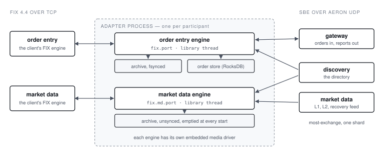

# 1. Introduction

## 1.1 What this adapter is

The most-exchange FIX adapter puts a FIX 4.4 interface in front of most-exchange. A participant's
FIX engine connects to it over TCP; the adapter speaks to the exchange's order entry gateways and
market data feeds over Aeron, in the exchange's binary SBE protocol, through most-exchange's own
`client` SDK. It is one Java process, built on Artio, the FIX engine of the Aeron family.

It is a protocol adapter and nothing more. It adds no order types, no risk checks and no matching:
an order is accepted at the adapter only if the exchange can carry it, and every exchange rule is
the exchange's (most-exchange's `docs/Adapters.md`, which this adapter implements).

What it does add is **state**. The exchange delivers each execution report once, numbered, and the
adapter promises the FIX client that no report is lost and no order's fate is misreported, across
its own crashes, the client's disconnections and a gateway's failover. Most of this manual's
operational advice follows from that promise.

::: term Participant
The exchange's trading identity: a number in the exchange's participant registry. Every order
carries one. In the adapter, a FIX order-entry session acts for exactly one participant, set in its
configuration; nothing on a FIX message can name another.
:::

::: term Order entry, market data
The adapter's two **roles**. An order-entry session sends orders and cancels and receives execution
reports. A market-data session asks for the security list and subscribes to books. A session has
one role, fixed in the configuration, and logs on at that role's own port.
:::

## 1.2 The process and its parts

One adapter process runs two FIX engines, each with its own port, embedded media driver and
archive:

| Part | What it does |
| --- | --- |
| Order entry's Artio engine | Accepts the order-entry sessions on `fix.port`. Records every FIX message in and out in an **archive fsynced to disk** |
| Order entry's library thread | Decodes and validates 35=D, F, H and AF; writes the **order store**; sends to the exchange once the archive has the request; turns the exchange's reports into 35=8 and 35=9 |
| The order store | RocksDB, in `fix.storeDir`: one row per order and per cancel, and how far each participant's reports have been durably delivered |
| Market data's Artio engine | Accepts the market-data sessions on `fix.md.port`, with an archive that is not synced and is emptied at every start |
| Market data's library thread | Answers 35=x and 35=V from the exchange's directory and feeds |
| The embedded media drivers | One per engine. Order entry's also carries the exchange links: the gateways and the directory |

Order entry and market data are separate engines on purpose. Order entry's archive is fsynced and
every order waits for it (section 5.3); market data's messages on the same archive slowed order
entry measurably, so they have their own (Design §4).

::: term Archive
Aeron Archive's recording of every message an Artio engine sends and receives, in `fix.archiveDir`.
Order entry's is synced at `fileSyncLevel` 1: what it has recorded survives a host crash. It is
what FIX resends come from, and what the adapter waits on before an order goes to the exchange and
before a report is counted as delivered.
:::

## 1.3 Two boundaries

The adapter sits between two networks, and is the only thing that should touch both:

- **The FIX side:** plain TCP, FIX 4.4, one port for order entry and one for market data. Artio
  does not encrypt; TLS, where needed, is terminated in front of the adapter (section 3.2).
- **The exchange side:** Aeron UDP to the exchange's gateway endpoints, its directory broadcast and
  its market data feeds. The adapter learns the gateways from the directory; it is never configured
  with the exchange's cluster.

## 1.4 The two kinds of configuration

The adapter reads two files, both Java properties:

- **The node file**, `fix.*` keys: ports, directories, the exchange's channels, the calendar, the
  threads. Given as the only argument: `adapter /config/adapter.properties`. Any `fix.*` JVM system
  property overrides the file's key (section 4.1).
- **The sessions file**, named by `fix.sessionsFile`: one block per FIX session, with its CompIDs,
  username, the SHA-256 of its password, its role and, for order entry, its participant
  (section 4.7).

The adapter checks both completely at start and refuses to start on anything missing or malformed,
before it accepts a single Logon.

The exchange has configuration of its own that must agree: every participant the adapter's
sessions act for must be one the gateway it connects through may speak for (section 4.9).

## 1.5 Prices, quantities and identifiers

**Prices and quantities are decimals on FIX and fixed-point integers at the exchange**, with eight
implied decimals: a price of `100.25` is `10025000000` at the exchange. The adapter converts
exactly. A value with more than eight decimals is refused, never rounded. Tools that speak to the
exchange directly, most-exchange's `most` CLI among them, take the raw integer: `--qty 400000000`
is four shares.

**Identifiers** a client sees:

| Identifier | Tag | What it is |
| --- | --- | --- |
| ClOrdID | 11 | The client's, unique per session for the trading day and while the order is open |
| OrderID | 37 | The exchange's order id; `NONE` until the order is acknowledged |
| ExecID | 17 | The exchange's report sequence number, in decimal, for a report from the exchange; `A<index>.<MsgSeqNum>` for a message the adapter answered itself |

The exchange's own `clOrdId` is not the client's: the adapter derives it from the FIX session,
`(sequenceIndex << 32) | MsgSeqNum` of the 35=D or 35=F. That is why the session's sequence
numbers matter to the store, and why wiping the adapter's state while the exchange keeps the
participant's orders is unsafe (section 6.7).

## 1.6 Sessions and participants

- **One order-entry session, one participant.** Two order-entry sessions may not share a
  participant: reports route back one to one.
- **The adapter is the acceptor.** Its CompID is the session's `senderCompId`; the client's is
  `targetCompId`.
- **Order-entry sessions are persistent.** Their sequence numbers survive Logouts and adapter
  restarts, and reset only when the client logs on with ResetSeqNumFlag (141=Y). A report for a
  client that is logged out is written to its session offline, and resent at its next Logon.
- **Market-data sessions are transient.** They start at MsgSeqNum 1 at every Logon, and keep
  nothing between Logons.
- **Deployment:** one adapter per participant, with that participant's order-entry session and a
  market-data session beside it.

## 1.7 What is not built

Designed in `docs/Design.md`, not built yet:

- the control API (`/status`, `/start`, `/stop`, session resets, a trading date override) and
  `/metrics` (Design §9.1–§9.2);
- a session schedule: a configured session may log on at any time (Design §8.2);
- several order-entry sessions for one participant (Design §8.27).

The manual marks each in a *todo* callout where an operator would otherwise expect it to work; the
consolidated list is in 6.9.

## 1.8 How to read this manual

Section 2 brings the adapter up beside most-exchange's development stack and is the fastest way to
learn the vocabulary. Section 3 is production. Section 4 is the complete configuration reference,
to be consulted rather than read. Section 5 is how the adapter behaves day to day: sessions, the
order path, delivery, restarts. Section 6 is diagnosis and maintenance. Section 7 indexes terms,
commands and every configuration key.

Command transcripts are real output from a running system, not illustrations.

The participant's side, the FIX messages and tags, is the companion document, the **Rules of
Engagement** (`docs/RulesOfEngagement.pdf`). In the repository: `docs/Design.md` is the
authoritative specification, `docs/Rationale.md` says why each rule exists, `deploy/README.md`
covers the Docker setup, and most-exchange's `docs/OperatorManual.pdf` covers the exchange.
