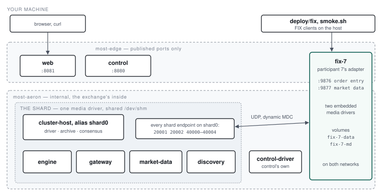

# 2. Development deployment and operation

This section brings participant 7's adapter up beside most-exchange's development stack, on one
machine, in Docker. Everything here is development-only in the ways 2.9 lists; production is
section 3.

## 2.1 Prerequisites

| | |
| --- | --- |
| JDK 21 | Builds the adapter and the `fix` client (`./gradlew`) |
| Docker with Compose | Docker Desktop on a Mac. Give its VM room: the exchange's stack and the adapter map about 3 GB of tmpfs between them (6.5) |
| A GitHub token | `read:packages`, for most-exchange's SDK: `githubUser` and `githubPackagesToken` in `~/.gradle/gradle.properties`, never in the repository or the shell |
| most-exchange | Checked out beside this repository as `../most-exchange`, its own stack built (`./gradlew installDist` there) |

## 2.2 Build

```sh
./gradlew build                                   # compiles, runs every module's tests
./gradlew :adapter:installDist :tools:installDist # bin/adapter and bin/fix
```

`installDist` gives `adapter/build/install/adapter/bin/adapter`, the process, and
`tools/build/install/fix/bin/fix`, the FIX client used throughout this manual. The SDK comes from
most-exchange's GitHub Packages; `-PmostExchange.local=true` builds against `../most-exchange`
instead, for changing the SDK and the adapter together.

## 2.3 The dev stack beside most-exchange's

The adapter is a compose project of its own, `most-fix`, in `deploy/`. It does not change
most-exchange's stack; it joins two of its networks:



- **`most-aeron`**, the exchange's inside, `internal: true`. The adapter reaches the gateway, the
  directory and the market data feeds over UDP here.
- **`most-edge`**, the only network with published ports. The adapter's FIX ports are published on
  it: 9876 for order entry and 9877 for market data.

The adapter is the one container on both, which is the place most-exchange's compose file leaves
for an adapter. It brings its own media drivers, embedded; it shares no Aeron directory with any
other container. Every exchange endpoint is on `shard0`, the network alias of most-exchange's
`cluster-host`, whose media driver binds all of the shard's endpoints, and it subscribes by
dynamic MDC because a Docker bridge does not route multicast.

```sh
(cd ../most-exchange/deploy && docker compose up -d)   # the exchange first: its networks
docker compose -f deploy/docker-compose.yml up -d --build
```

### What the container is

| | |
| --- | --- |
| Image | `deploy/Dockerfile`: the host's `adapter/build/install/adapter` on `eclipse-temurin:21-jre`, user 10001. No Gradle inside Docker |
| Configuration | `deploy/config/adapter.properties` and `sessions.properties`, mounted read-only at `/config` |
| Volumes | `fix-7-data` at `/data`: order entry's archive, Artio's logs, the store. `fix-7-md` at `/data-md`: market data's engine, emptied at every start |
| `/dev/shm` | 1 GB, for the two embedded drivers |
| Stop | SIGTERM, 30 s grace: the clean stop (5.6) |
| Restart | `unless-stopped`: after a crash it retries until the archive's mark file has aged out (6.6) |
| Health | The order-entry port accepts a connection. The acceptor binds last, so an open port is a started adapter |

The sessions, with development secrets committed as most-exchange's are:

| Session | Port | CompIDs (client → adapter) | Username / password |
| --- | --- | --- | --- |
| Order entry, participant 7 | 9876 | CLIENT7 → MOST | `client7` / `client7-secret` |
| Market data | 9877 | FEED7 → MOST | `feed7` / `feed7-secret` |

## 2.4 Verifying the stack came up

```console
$ docker logs most-fix-fix-7-1 2>&1 | grep -v SVE
adapter: started, listening on 0.0.0.0:9876 for 1 order-entry sessions, 0.0.0.0:9877 for 1 market-data; trading date 20261031, idle backoff
order entry: shard 0 through aeron:udp?endpoint=shard0:20001:20
order entry: shard 0 ready
```

Three lines, in this order:

1. **`adapter: started`** names both ports, the session counts, the trading date the calendar gives
   day orders, and the idle strategy. The ports are open from this line on.
2. **`shard 0 through …`**: the directory has arrived, and the adapter has a session with the
   gateway it names, as `channel:streamId`.
3. **`shard 0 ready`**: that session's opening mass status has finished. Orders for shard 0's
   securities go to the exchange from here; before it they are refused "exchange unavailable".

`started` without `shard 0 through` means no directory: see 6.2.

## 2.5 The FIX client

`deploy/fix` runs the host's `fix` client with participant 7's connection details filled in. Order
commands log on as CLIENT7 at 9876; `securities` and `md` log on as FEED7 at 9877. The client
keeps its MsgSeqNums in `build/deploy/clients`, so each command is a Logon, the request, and a
Logout, in sequence with the last.

| Command | Sends |
| --- | --- |
| `send --symbol S --side buy\|sell --price P --qty Q --clordid ID [--tif day\|gtc\|ioc\|fok]` | 35=D |
| `cancel --clordid ID --orig ID --symbol S --side buy\|sell --qty Q` | 35=F |
| `status --clordid ID --symbol S --side buy\|sell` | 35=H |
| `mass-status [--side buy\|sell]` | 35=AF, all orders |
| `listen [--follow SECONDS]` | Only a Logon: prints what is owed |
| `securities` | 35=x |
| `md --symbol S[,S…] [--depth 0\|1]` | 35=V, snapshot plus updates |

Every application message received is printed on one line. `--follow` (default 3 s) is how long
the client stays logged on after its request.

## 2.6 Driving a trade

A sell from participant 7 through FIX, a buy from participant 8 through most-exchange's own CLI,
and the fill reported to participant 7 at its next Logon:

```console
$ deploy/fix send --symbol AAPL --side sell --price 100.00 --qty 10 --clordid S1793473103 --follow 2
logged on as CLIENT7
ExecutionReport ClOrdID=S1793473103 OrderID=20030 ExecID=29 ExecType=NEW OrdStatus=NEW Side=SELL Symbol=AAPL OrderQty=10 Price=100 CumQty=0 LeavesQty=10 AvgPx=0
Logout MsgSeqNum=20075

$ (cd ../most-exchange/deploy && ./most send --symbol AAPL --side buy --price 100.00 \
      --qty 400000000 --clordid 1793473103 --participant 8 --follow 2)
  NEW  AAPL  orderId=20031 clOrdId=1793473103  leaves 400000000 cum 0 of 400000000
  TRADE  AAPL  orderId=20031 clOrdId=1793473103  last 400000000 @ 100.00 cum 400000000 leaves 0

$ deploy/fix listen --follow 3
logged on as CLIENT7
ExecutionReport ClOrdID=S1793473103 OrderID=20030 ExecID=30 ExecType=TRADE OrdStatus=PARTIALLY_FILLED Side=SELL Symbol=AAPL OrderQty=10 Price=100 LastQty=4 LastPx=100 CumQty=4 LeavesQty=6 AvgPx=100 PossDup
Logout MsgSeqNum=20078
```

The fill arrived while CLIENT7 was logged out. The adapter wrote its 35=8 to the session offline,
and at the Logon the client saw a gap and asked for it: it comes back with PossDup=Y (5.4).

::: warning `most send --qty` is the raw integer
most-exchange's CLI takes the exchange's fixed-point quantity: `--qty 400000000` is four shares.
`--qty 4` would be 0.00000004 of a share, and the FIX client would see `LastQty=0.00000004`.
:::

`deploy/smoke.sh` does all of this, plus market data and a cancel, with new ids each run:

```console
$ deploy/smoke.sh
ok: CLIENT7's sell S1793456447 rests
ok: participant 8 crossed it through most-exchange's CLI
ok: CLIENT7 was told of the fill at its next Logon
ok: FEED7 has the security list and AAPL's book
ok: the rest of S1793456447 cancelled
```

It assumes participant 7 has no older order at the same price ahead of its sell in the book.

## 2.7 Watching the book

```console
$ deploy/fix securities --follow 2
logged on as FEED7
SecurityList SecurityReqID=SL-1793472920856 SecurityRequestResult=0 TotNoRelatedSym=2 LastFragment=Y Securities=[AAPL/1/USD/tick=0.01,MSFT/2/USD/tick=0.01]

$ deploy/fix md --symbol AAPL --depth 1 --follow 2
logged on as FEED7
MarketDataSnapshot MDReqID=MD-1793472923401 Symbol=AAPL Entries=[BID 99.98x0.00000089(1)]
```

A subscription prints its snapshot (35=W), then one line per change (35=X) for as long as
`--follow` lasts. The quantity above, 0.00000089, is a bid placed through `most` with a raw
`--qty 89`.

## 2.8 Stopping, restarting, crashing

| | What happens |
| --- | --- |
| `docker compose -f deploy/docker-compose.yml restart fix-7` | SIGTERM: the engine closes, the clean stop is marked, `adapter: stopped`. The next start moves no MsgSeqNum |
| The JVM killed (`docker exec most-fix-fix-7-1 sh -c 'kill -9 $(pgrep -f AdapterMainKt)'`) | Docker restarts it. For about 10 s the archive refuses its own mark file and the adapter exits; Docker retries. Once started it moves every order-entry session's MsgSeqNum on 10,000 (5.6) |

The crash, as it looks:

```console
adapter: refused to start: active mark file detected: /data/archive/archive-mark.dat
adapter: refused to start: active mark file detected: /data/archive/archive-mark.dat
order entry: participant 7: the last stop was not clean; MsgSeqNum moved on from 31 to 10031, 10000 Heartbeats (Design.md §8.21)
adapter: started, listening on 0.0.0.0:9876 for 1 order-entry sessions, 0.0.0.0:9877 for 1 market-data; trading date 20261031, idle backoff
order entry: shard 0 ready
```

## 2.9 What is development-only

- **The secrets** in `deploy/config/sessions.properties` are committed (their SHA-256 only).
- **The calendar** is UTC and every day of the week, because the exchange's seed opens the shard
  with the control container's date, on any day (section 4.4). Production uses the exchange's
  calendar.
- **Shared driver threads and a backing-off idle strategy** (`ADAPTER_OPTS`,
  `fix.idleStrategy=backoff`): the whole exchange runs on the same machine. Production busy-spins.
- **The fsync is the VM's.** No latency figure taken in Docker Desktop is the adapter's.
- **Dynamic MDC instead of multicast**, as in most-exchange's stack.

## 2.10 Running without Docker

The e2e scripts run the adapter from its install against most-exchange's installs, and are the
reference for a bare-metal layout. `e2e/exchange.sh` writes both files; its node file:

```properties
fix.bindAddress=localhost
fix.port=29880
fix.logDir=build/e2e/adapter/logs
fix.archiveDir=build/e2e/adapter/archive
fix.aeronDir=build/e2e/adapter/aeron
fix.fileSyncLevel=1
fix.sessionsFile=build/e2e/sessions.properties
fix.storeDir=build/e2e/adapter/store
fix.directoryChannel=aeron:udp?endpoint=localhost:0|control=localhost:40101|control-mode=dynamic
fix.directoryStreamId=100
fix.md.port=29881
fix.md.logDir=build/e2e/adapter/md-logs
fix.md.archiveDir=build/e2e/adapter/md-archive
fix.md.aeronDir=build/e2e/adapter/md-aeron
fix.md.l1.channel=aeron:udp?endpoint=localhost:0|control=localhost:40201|control-mode=dynamic
fix.md.l1.streamId=31
fix.md.l2.channel=aeron:udp?endpoint=localhost:0|control=localhost:40202|control-mode=dynamic
fix.md.l2.streamId=32
fix.md.snapshot.channel=aeron:udp?endpoint=localhost:0|control=localhost:40204|control-mode=dynamic
fix.md.snapshot.streamId=34
fix.calendar.zone=UTC
fix.calendar.rollTime=23:59
fix.calendar.weekdays=MON,TUE,WED,THU,FRI,SAT,SUN
fix.idleStrategy=backoff
```

(the paths shortened from the script's `$RUN`, the channels as it writes them.)

```sh
ADAPTER_OPTS="-Daeron.threading.mode=SHARED -Daeron.archive.threading.mode=SHARED" \
  adapter/build/install/adapter/bin/adapter build/e2e/adapter.properties
```

The start script carries the JVM flags the adapter needs (4.8); `ADAPTER_OPTS` adds to them.

## 2.11 Automated checks

| Command | What it proves | Needs |
| --- | --- | --- |
| `./gradlew build` | Every module's tests, against a real Artio engine and initiator and modelled gateways. What CI runs (`.github/workflows/ci.yml`) | JDK 21 |
| `./e2e/run-e2e.sh` | FIX clients, the adapter and most-exchange's real processes: orders, crosses, offline delivery, market data, a clean restart, a SIGKILL under load and a report after it. Nine steps | most-exchange's installs |
| `./e2e/run-perf.sh` | The latency baseline (5.8) | The same, and a quiet machine |
| `deploy/smoke.sh` | The Docker stack, end to end (2.6) | Both stacks up |
| `./gradlew :spikes:test` | What Artio really does, the assumptions the design rests on. Minutes, with SIGKILLs; after an Artio or Aeron bump | — |

## 2.12 Shutting down

```sh
docker compose -f deploy/docker-compose.yml stop        # the adapter, cleanly; volumes kept
(cd ../most-exchange/deploy && docker compose stop)
```

`down -v` on the adapter discards its archive and order store. **Never do that alone** while the
exchange keeps participant 7's orders: see 6.7. It is how the dev stack upgraded to the exchange's
schema 8, beside the exchange's own restart on version 8 (6.7, "Upgrading the adapter").
