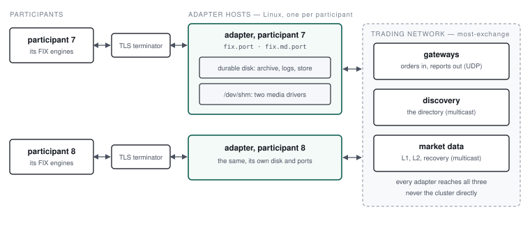

# 3. Production deployment

## 3.1 The rule that shapes everything

**The adapter's disk is its memory.** Two things on it carry the delivery promise:

- **order entry's archive**, `fix.archiveDir`, fsynced at `fileSyncLevel` 1. An order goes to the
  exchange only once the archive has recorded its 35=D, and a report counts as delivered only once
  the archive has recorded its 35=8 (section 5.3, 5.4);
- **the order store**, `fix.storeDir`, RocksDB with an unsynced write-ahead log, recovered as a
  prefix after a crash. Everything a host crash can take from it can be rebuilt from the archive.

So the archive's disk must make `fsync` mean what it says, and every order waits for it. On the
development laptop the archive's fsync is most of the adapter's latency (Design §8.24,
`docs/Measurements.md`). The figures there are a laptop's; measure on the target hardware, with
`e2e/run-perf.sh`, before relying on any.

::: warning Durability is claimed for Linux
On macOS `fsync` does not flush the drive's cache. The design's durability argument holds on Linux
with a disk that honours a flush; a laptop proves the ordering, not survival of a power loss.
:::

## 3.2 Topology

**One adapter per participant.** Each participant gets its own adapter process, with its
order-entry session and a market-data session beside it, on two ports. A participant's sessions
are isolated from every other's: a misbehaving client, a slow consumer or a restart touches one
participant.



What each side needs:

| Side | Needs |
| --- | --- |
| FIX | TCP from the participant to `fix.port` and `fix.md.port`. **Artio does not encrypt:** the password (554) crosses the network as sent. Put a TLS terminator in front, or a private line, never the open internet |
| Exchange | UDP to the gateways' order entry endpoints, and from their execution report channels; the directory broadcast; the L1, L2 and recovery feeds. In production the directory and the feeds are multicast (most-exchange Operator's Manual, 3.7) |
| Exchange registry | The participant listed for the gateway the adapter connects through (4.9) |

The adapter never connects to the exchange's cluster. It learns the gateways from the directory,
and the gateway enforces which participants it may act for.

## 3.3 Machine preparation

- **Linux**, x86-64. JDK 21 (Temurin is what the project builds and tests on).
- **A disk with power-loss protection** for `fix.archiveDir`, `fix.logDir` and `fix.storeDir`, on
  one filesystem the adapter owns. They are durable: never on tmpfs, never cleaned at boot.
- **`/dev/shm`** large enough for two embedded media drivers (`fix.aeronDir`, `fix.md.aeronDir`).
  An Aeron driver that cannot map a buffer dies of SIGBUS, which reads like a JVM bug (6.5). Size it
  from the drivers' term lengths; the development stack gives the container 1 GB.
- **Clock synchronisation.** Every FIX message carries SendingTime (52), and clients may reject a
  stale one. TransactTime (60) on reports is the adapter's clock.
- **Open files**: RocksDB and the archive's segments; raise `LimitNOFILE` above the default.

## 3.4 Threads and cores

| Thread | Busy by default |
| --- | --- |
| Order entry's library thread | Yes: `busyspin` |
| Market data's library thread | Yes: `busyspin` |
| Each engine's framer and archiver | Artio's own |
| Each embedded driver's conductor, sender, receiver, archive | Aeron's, `dedicated` threading |

`fix.idleStrategy` sets both library threads: `busyspin` (the default), `yielding`, `backoff` or
`sleeping`. A busy-spinning thread takes a core whether there is traffic or not; on a shared host,
or one with fewer cores than threads, use `backoff` and accept the wake-up latency. Aeron's own
threading is set with JVM properties (`-Daeron.threading.mode=SHARED`,
`-Daeron.archive.threading.mode=SHARED`), as the development stack does to fit beside the exchange.

## 3.5 Aeron

- **Two embedded drivers**, one per engine, in `fix.aeronDir` and `fix.md.aeronDir`. Each is
  deleted and recreated at start. Order entry's carries the gateway links and the directory as
  well as Artio's own streams: one process, one driver, so a driver fault takes FIX and the exchange
  links down together.
- **The subscriptions are the adapter's**: `fix.directoryChannel` and the `fix.md.*` feeds are
  subscriber channels, bound by the adapter's driver on its own host. Use the form the exchange's
  publisher expects, multicast in production, dynamic MDC (`endpoint=…|control=…`) where multicast
  is not routed.
- **The gateway's channels come from the directory**, unless listed in the node file (3.6).

## 3.6 Gateways and failover

By default each shard is reached through the one gateway the directory names. The SDK switches
gateways only among those it is given, so a **co-located shard**, a gateway on each cluster node,
needs its gateways listed, in the order to try them:

```properties
fix.shard.0.gateway.0.orderEntryChannel=aeron:udp?endpoint=node-a:20001
fix.shard.0.gateway.0.orderEntryStreamId=20
fix.shard.0.gateway.0.executionReportChannel=aeron:udp?endpoint=0.0.0.0:0|control=node-a:20002|control-mode=dynamic
fix.shard.0.gateway.0.executionReportStreamId=21
fix.shard.0.gateway.1.orderEntryChannel=aeron:udp?endpoint=node-b:20001
fix.shard.0.gateway.1.orderEntryStreamId=20
fix.shard.0.gateway.1.executionReportChannel=aeron:udp?endpoint=0.0.0.0:0|control=node-b:20002|control-mode=dynamic
fix.shard.0.gateway.1.executionReportStreamId=21
```

Listed gateways replace the directory's endpoint for that shard. **An endpoint that changes in a
later directory is logged, not followed**: the adapter keeps the links it started with until it is
restarted. A switch between gateways settles every request in flight by the exchange's resend
fence; a request that never reached the exchange is rejected "not sequenced (gateway failover)",
and one whose fate the resend cannot tell is restated with an unknown status, never rejected
(section 5.5).

## 3.7 Market data feeds

The adapter subscribes to the same three feeds most-exchange's market data process publishes:

| Keys | most-exchange's key | Carries |
| --- | --- | --- |
| `fix.md.l1.channel`, `.streamId` | `md.l1.*` | Last trades |
| `fix.md.l2.channel`, `.streamId` | `md.l2.*` | Depth updates |
| `fix.md.snapshot.channel`, `.streamId` | `md.snapshot.*` | The recovery feed: an image of each book in turn |

A book is trusted once the recovery feed has given an image of it; until then a subscription's
snapshot waits. The directory (for the security list) is the order-entry keys' `fix.directoryChannel`.

## 3.8 Process management

The adapter is one process with a clean stop on SIGTERM: its shutdown hook closes the backends and
the engines, waits for the archive to record what was sent, and marks the clean stop in the store
(5.6). Give it time, and restart it after a crash, slowly enough for the archive's mark file to age
out (~10 s).

An example unit, not run as part of the project's checks:

```ini
# /etc/systemd/system/most-fix@.service: one instance per participant, most-fix@7
[Unit]
Description=most-exchange FIX adapter, participant %i
After=network-online.target
Wants=network-online.target

[Service]
User=most-fix
Environment="ADAPTER_OPTS=-Xms2g -Xmx2g"
ExecStart=/opt/most-fix/adapter/bin/adapter /etc/most-fix/%i/adapter.properties
KillSignal=SIGTERM
TimeoutStopSec=30
Restart=always
RestartSec=3
LimitNOFILE=65536

[Install]
WantedBy=multi-user.target
```

A restart within ~10 s of a crash fails with `active mark file detected`; `Restart=always` with a
few seconds' delay retries until it starts. A clean stop that is cut short (the timeout, a second
signal) counts as a crash at the next start.

## 3.9 Bringing an adapter up

1. **On the exchange:** the participant listed for its gateway (4.9), and the gateway reachable.
2. **The sessions file:** generate each client's secret, store only its SHA-256 (4.7), and hand the
   secret to the participant out of band with the CompIDs, ports and the Rules of Engagement.
3. **The node file:** the directories on the durable disk, the ports, the exchange's channels, the
   calendar matching the exchange's (4.4).
4. **Start it** and read the log for `adapter: started`, then `shard N through …` and
   `shard N ready` for every shard (2.4).
5. **The client logs on.** Its first Logon on a new session is at MsgSeqNum 1, both ways.

### Before the first trading day

- The calendar: does `trading date` in the start line name the exchange's trading date?
- A refused Logon (a wrong password) gets `Logon refused` and nothing else; a right one is
  answered with a Logon (5.2). Try both before handing over.

## 3.10 Blocking gaps

What production would want that is not built:

::: todo Control API and metrics
`/status`, `/start`, `/stop`, session resets, the trading date override and `/metrics` are
designed (Design §9) but not built. Today the adapter is observed through its log alone (5.9), and
a session's sequence numbers are reset only by the client (141=Y).
:::

::: todo Session schedule
A configured session may log on at any time; nothing logs sessions out at the close or resets them
at the end of the day (Design §8.2). Sequence numbers run on across days until a client resets.
:::

::: todo TLS
Artio's acceptor is plain TCP. TLS is terminated in front of the adapter, by something else.
:::
