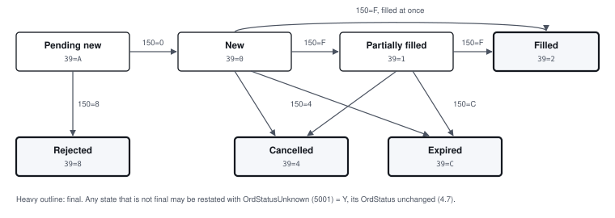

# 4. Order types and lifecycle

## 4.1 Limit orders only

The exchange matches **limit orders** on one book per security, by price and then time. An order
is OrdType (40) `2` with a Price (44). The exchange runs trading phases (pre-open, an opening
auction, continuous trading, closed); an order outside the phases that accept it is rejected
`MARKET_CLOSED` (OrdRejReason 2).

Refused at the venue's interface, before the market, with OrdRejReason 99 and a fixed Text
(section 6.1):

| Not supported | Text |
| --- | --- |
| Market, stop and any OrdType but 2 | `limit orders only` |
| IOC (59=3), FOK (59=4), at the open or close (59=2, 7), GTX | `time in force 0, 1 or 6 only` |
| Replace (35=G) | `replace not supported`, on a 35=9 |

## 4.2 Time in force

| TimeInForce (59) | Lives until |
| --- | --- |
| `0` Day, or absent | The end of the trading day. The venue stamps it with the venue's trading date when it arrives; it is reported expired (ExecType C) when the exchange purges the day's orders |
| `1` Good till cancel | Cancelled or filled; kept across days |
| `6` Good till date | The end of ExpireDate (432), `YYYYMMDD`. A date already past is rejected `ORDER_EXPIRED` |

## 4.3 Self-match prevention

The exchange does not let an order trade with another order of the same **SMP id**. An order's SMP
id is its SelfMatchPreventionID (2362) if sent, otherwise your participant: **by default your own
orders never trade with each other**.

When an incoming order would match one with the same SMP id, the incoming order's
SelfMatchPreventionInstruction (2964) decides:

| 2964 | Effect |
| --- | --- |
| `1`, or absent | Cancel the incoming order's remainder; the resting order stays |
| `2` | Cancel the resting order and go on matching |

The order cancelled gets a 35=8 ExecType 4 with Text `SELF_MATCH_PREVENTED`. A self-match prints no
trade. Give different SMP ids to strategies that may trade with each other: two orders with
different SelfMatchPreventionIDs match normally.

## 4.4 Order states

| OrdStatus (39) | Means | Final |
| --- | --- | --- |
| `A` Pending new | Received by the venue, not yet acknowledged by the exchange. Seen on a status answer or a cancel reject | No |
| `0` New | Resting in the book | No |
| `1` Partially filled | Resting, partly filled | No |
| `2` Filled | Fully filled | Yes |
| `4` Cancelled | Cancelled by you, by self-match prevention, by a volatility halt or by the exchange's operator | Yes |
| `C` Expired | A day or GTD order past its date | Yes |
| `8` Rejected | Refused, by the venue's interface or by the exchange | Yes |

**Status unknown** is not a state of its own: an order whose fate the venue cannot tell keeps the
OrdStatus last reported, flagged with OrdStatusUnknown (5001) = Y (4.7).

## 4.5 Cancelling

- **By you:** an OrderCancelRequest (3.4). The answer is the order's 35=8, ExecType 4, or a 35=9
  saying why not (6.3).
- **Unsolicited**, a 35=8 ExecType 4 for the order, Text naming the reason:

  | Text | Why |
  | --- | --- |
  | `SELF_MATCH_PREVENTED` | Self-match prevention (4.3) |
  | `VOLATILITY_HALT` | The incoming order's remainder, at a dynamic collar breach |
  | absent | Cancelled by the exchange's operator |

- **No cancel on disconnect.** Your orders stay in the book when you log out or lose the connection.

## 4.6 Asking for status

- **One order:** OrderStatusRequest (35=H) by ClOrdID (3.6).
- **All open orders, or those of one security:** OrderMassStatusRequest (35=AF) (3.7). Use it after
  a reset (2.7) or whenever your view and the venue's may differ.

Both are answered from the venue's record of what it has told you: they never contradict the reports
you received.

## 4.7 An order whose fate is unknown

When the exchange's gateway fails over, the venue settles every order in flight with the exchange's
own resend:

- **An order that never reached the exchange** is rejected, OrdRejReason 99, Text
  `not sequenced (gateway failover)`. It did not trade. You may send it again, under a new ClOrdID.
- **An order whose fate the resend cannot tell** is not open at the exchange, but may have traded
  before it stopped being open. The venue **never reports it as rejected, cancelled, expired or
  done**, since you might then enter its quantity again. It restates it, ExecType I, with the
  OrdStatus, CumQty and LeavesQty you were last told, and:
  - OrdStatusUnknown (5001) = `Y`;
  - Text `STATUS UNKNOWN: not open at the exchange; fills since CumQty=<n> unrecoverable until reconciled`.

**What to do with an unknown order:** treat it as not working, and its fills since the CumQty stated
as unknown. Do not resend it as if it had not traded. Ask the venue's operations to reconcile it. A
later report for it, if one arrives, clears the flag. A cancel for it is answered at once with a
35=9, CxlRejReason 99 and the same flag.

A cancel in flight at a failover is settled the same way: never sequenced, a 35=9 CxlRejReason 99
`not sequenced` (the order is unchanged); unknown, a 35=9 with OrdStatusUnknown = Y and Text
`cancel status unknown`.

## 4.8 Duplicates, resends and ClOrdID

- **A ClOrdID is 1 to 20 characters**, each one of `A-Z a-z 0-9 - _ + ; : . /`, on an order and on a cancel.
  It is carried to the exchange as you sent it, and comes back as you sent it on every report. One
  that does not fit, a 36-character UUID among them, is rejected at once and never reaches the
  market: a 35=D with OrdRejReason 99, a 35=F with a 35=9, CxlRejReason 99, both with Text
  `ClOrdID must be 1-20 of A-Z a-z 0-9 - _ + ; : . /`. A cancel whose OrigClOrdID does not fit
  names no order: 35=9, CxlRejReason 1, `unknown order`.
- **A new 35=D with a ClOrdID the session already used** for an order still open, or that day, is
  rejected, OrdRejReason 6, Text `duplicate ClOrdID`. A cancel's ClOrdID counts as used too.
- **A resent 35=D or 35=F (PossDupFlag = Y) the venue already has** is not executed again. If it
  was answered, the resend is dropped and the answer is not repeated; if not, it is answered once.
- **The same message delivered twice**, by your engine's resend or the venue's own recovery, is
  recognised by its MsgSeqNum and processed once.
